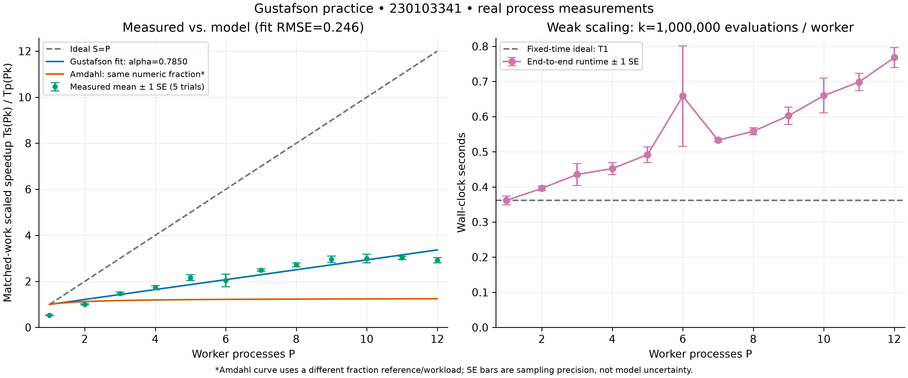

# Gustafson's Law and Weak Scaling

**Ayazgaliyev Aibek · 230103341**

Parallel & Distributed Computing Architecture · Instructor: Sufyan bin Uzayr

## Summary

I completed 25 tasks covering scaling laws, worked calculations, workload analysis,
a simulator, and a real multiprocessing experiment. My main conclusion is that
Gustafson's law concerns **larger workloads within a time budget**, whereas Amdahl's
law concerns **faster execution of a fixed workload**.

## Main formulas

I use P for processors, α for the serial fraction of parallel elapsed time,
and f for the serial fraction of the same workload on one processor.

```text
Gustafson speedup:     S = P − α × (P − 1)
Scaled efficiency:    E = S / P = 1 − α + α / P
Amdahl speedup:       S = 1 / [f + (1 − f) / P]
Same-work conversion: f = α / [P − α × (P − 1)]
```

For constant α, efficiency approaches 1 − α. The two serial fractions have
different reference times; I convert them before comparing the same workload.
Communication, memory limits, and growing critical paths can prevent ideal scaling.

## Experimental results

I measured **60 real trials** on **5 November 2026**, using P = 1–12 with five
trials each. My host was a Ryzen 5 7640HS laptop with **6 cores / 12 logical
processors**, Windows 11, and CPython 3.14.3.

Each worker evaluated 1,000,000 midpoint-integration points for 4 / (1 + x²).
I compared parallel time, including process startup and cleanup, with a direct
serial execution of the **same total work**. I retained all observations.

| Workers | Mean parallel time | Mean scaled speedup | Scaled efficiency |
|---:|---:|---:|---:|
| 1 | 0.361641 s | 0.527832 | 52.7832% |
| 6 | 0.658308 s | 2.040563 | 34.0094% |
| 11 | 0.698435 s | 3.020116 | 27.4556% |
| 12 | 0.768045 s | 2.919229 | 24.3269% |

My Gustafson fit gives **α̂ = 0.784991225892**, **RMSE = 0.246365**, and
**R² = 0.905843**. This α̂ summarizes effective overhead; it is not a directly
measured serial-code fraction. Runtime increased with P, so my implementation
did **not** achieve ideal constant-time weak scaling.



[Vector PDF](plots/scaling_comparison.pdf) ·
[Statistics and regression](analysis/task23_experimental_results.md) ·
[Hardware audit](analysis/task24_hardware_audit.md)

## Task index

| Task | My submission |
|---:|---|
| 01 | [Strong and weak scaling](theory/task01_scaling_models.md) |
| 02 | [Gustafson derivation](theory/task02_derivation.md) |
| 03 | [Serial fraction and reference time](theory/task03_serial_invariance.md) |
| 04 | [Asymptotic limits](theory/task04_asymptotic_limits.md) |
| 05 | [Historical nCUBE results](theory/task05_historical_ncube.md) |
| 06 | [Parametric table](calculations/task06_parametric_table.md) |
| 07 | [Maximum serial fraction](calculations/task07_tolerable_serial.md) |
| 08 | [Amdahl–Gustafson comparison](calculations/task08_cross_divergence.md) |
| 09 | [Multiple runtime components](calculations/task09_multicomponent.md) |
| 10 | [Memory-limited growth](calculations/task10_memory_growth.md) |
| 11 | [Sun–Ni comparison](theory/task11_sun_ni_comparison.md) |
| 12 | [Communication penalty](theory/task12_communication_penalty.md) |
| 13 | [Scaling failure cases](theory/task13_failure_cases.md) |
| 14 | [Isoefficiency](theory/task14_isoefficiency.md) |
| 15 | [Energy scaling](theory/task15_energy_scaling.md) |
| 16 | [GEMM scaling](calculations/task16_gemm_scaling.md) |
| 17 | [Stencil scaling](calculations/task17_stencil_scaling.md) |
| 18 | [N-body scaling](analysis/task18_nbody_scaling.md) |
| 19 | [Monte Carlo](analysis/task19_monte_carlo.md) |
| 20 | [Graph processing](analysis/task20_graph_processing.md) |
| 21 | [Simulator](benchmarks/simulator.py), [predictions](calculations/simulated_scaling.csv), [plot](plots/model_overlay.pdf) |
| 22 | [Benchmark code](benchmarks/weak_scale_bench/benchmark.py), [method](benchmarks/weak_scale_bench/README.md) |
| 23 | [Raw trials](benchmarks/results.csv), [fitter](benchmarks/fit_gustafson.py), [report](analysis/task23_experimental_results.md) |
| 24 | [Hardware and limitations](analysis/task24_hardware_audit.md), [plot](plots/scaling_comparison.pdf) |
| 25 | This summary, task index, and validation |

## Reproduction

My scripts require Python 3.10+; only plotting requires Matplotlib.
These PowerShell commands use my absolute checkout path:

```powershell
$root = 'C:\Users\aiblb\PycharmProjects\CSS314_10.09.2026_230103341\gustafson-law-practice'

# Optional plotting dependency.
py -m pip install -r "$root\requirements-plots.txt"

# Analytical predictions and plots, not measured trials.
py "$root\benchmarks\simulator.py"
# Example custom parameters:
py "$root\benchmarks\simulator.py" --cores 1,16,64,1024 --fractions 0.001,0.04,0.20 --csv "$root\calculations\custom_scaling.csv" --no-plots

# Reanalyze retained measurements without changing the raw CSV.
py "$root\benchmarks\fit_gustafson.py"
py "$root\benchmarks\report_results.py"

# New measurements go to a separate file.
py "$root\benchmarks\weak_scale_bench\benchmark.py" --output "$root\benchmarks\repeat.csv"

# Tests and artifact verification.
py "$root\benchmarks\test_practice.py"
py "$root\benchmarks\verify_artifacts.py"
```

## Validation and conclusion

I checked model identities, numerical answers, regression inputs, real spawned
workers, Markdown readability, report regeneration, links, and output artifacts.
My evidence is in [test output](benchmarks/logs/tests.txt) and the
[verification manifest](benchmarks/logs/verification.json).

I kept [session metadata](benchmarks/results.metadata.json),
[summary statistics](benchmarks/summary.csv), and [fit residuals](benchmarks/fit.json)
alongside the raw data. Historical cluster findings are cited separately from my
laptop measurements. I conclude that useful work can scale well only when
communication, memory, synchronization, and hardware overhead remain controlled.