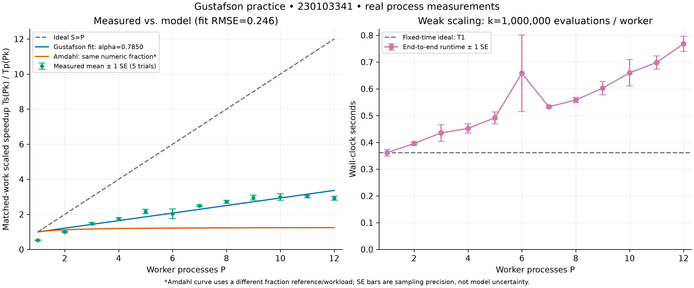

# Task 24 — Hardware audit and measured/model discrepancy

**Student ID: 230103341.** I measured this shared-memory laptop on **5 November 2026**, not a multinode cluster. [Metadata](../benchmarks/results.metadata.json) retains execution times, timezone and raw CIM evidence. I distinguish host observations from [AMD specifications](https://www.amd.com/en/products/processors/laptop/ryzen/7000-series/amd-ryzen-5-7640hs.html), consulted that day; specifications establish capabilities, not active channels or clocks. I installed no driver.

## Hardware evidence

| Item | Observation / qualification |
|---|---|
| Host / CPU | CIM: Lenovo 82Y9; AMD Ryzen 5 7640HS with Radeon 760M Graphics |
| Resources | CIM: 6 physical cores / 12 SMT threads; AMD: Zen 4, one package die |
| Cache | AMD: L1 384 KB, L2 6 MB, L3 16 MB; CIM: L2 6144 KB, L3 16384 KB; not timing measurements |
| RAM | CIM: two 8,589,934,592-byte modules (16 GiB installed); OS-visible 16,309,932,032 bytes |
| Memory controller | CIM configured rate 5600/module, interpreted as DDR5-5600-class—not measured bandwidth; AMD supports 2 channels, active occupancy/interleave unverified |
| Software | Windows 11 Pro build 26300; CPython 3.14.3 64-bit; version/path captured; localized caption encoding may be imperfect |
| Timing / processes | Explicit `spawn`; `perf_counter_ns`, reported resolution 100 ns—not accuracy |
| Controls / telemetry | OS-managed placement/power; no affinity/power-plan changes; frequency, temperature, package energy and NUMA topology unmeasured; CIM MaxClockSpeed=4301 is not a trial trace |

## Scaling evidence



My figure has labeled axes, legend, distinct styles/colors and a runtime panel. [Vector PDF](../plots/scaling_comparison.pdf) and 300-dpi raster PNG are generated by `benchmarks/fit_gustafson.py`. With P workers, speedup S and fitted effective coefficient α̂:

```text
Ideal: S = P
Fit: S = 0.215008774108P + 0.784991225892
Amdahl illustration: S = 1/[α̂ + (1 − α̂)/P]
```

I plot means of five paired matched-work ratios and runtime means, each ±1 SE (sample SD/√5), not SD or 95% intervals. [Summary](../benchmarks/summary.csv), [fit](../benchmarks/fit.json) and [Task 23](task23_experimental_results.md) retain points, uncertainty, coefficients and residuals. Amdahl reuses the coefficient numerically but means single-core fixed-work serial fraction, not parallel-runtime fraction; it is not a prediction for these scaled jobs.

Work grew from **1,000,000 to 12,000,000 points**, fixed per process; every run returned the expected integral and P distinct PIDs. Mean runtime rose **0.361641 → 0.768045 s**: not fixed-time weak scaling. Twelve-worker weak runtime efficiency was **0.470859**; matched-work speedup **2.919229×**, scaled efficiency **24.3269%**. Eleven workers gave the largest mean, **3.020116×**. Fitted α̂ = **0.784991**, RMSE **0.246365**, descriptive R² **0.905843**. This regression coefficient is not an instrumented serial fraction; extrapolation to **P=65,536** is unjustified. I retained all five noisy P=6 samples (runtime SD **0.319848 s**) without selective reruns.

## My interpretation and limits

Source inspection confirms each sample spawns P interpreters, pipes P small results, and includes startup/cleanup. P=1 speedup is about **0.528** because its direct serial reference starts no child: a timer-scope difference violating ideal S(1)=1, not grounds to alter data.

Six-core sharing, SMT beyond six workers, interpreter dispatch, scheduling/background load and different serial/all-core boost states are plausible, not isolated causes. This loop is neither native SIMD GEMM nor a large-array bandwidth test; it establishes no channel saturation. I cannot attribute P=6 noise to thermal throttling or a six-to-seven-worker change to NUMA: neither was instrumented. My proposed—not completed—follow-up compares labeled persistent-worker steady state, varies per-worker work, randomizes repetitions, logs clocks/temperature/power, and audits affinity, NUMA nodes, first-touch placement and local/remote traffic under controlled cooling/load.