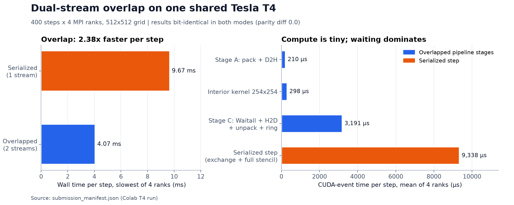
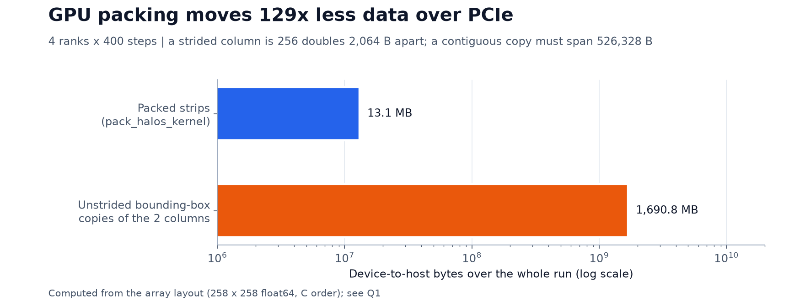
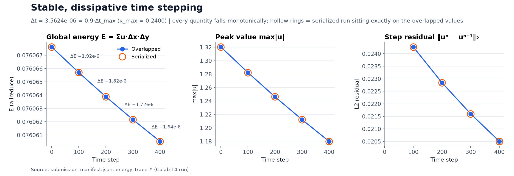

# Distributed Stencil & Asynchronous Halo Exchange in MPI + CUDA

### Lecture lab · 19 November 2026 · 11:30

**Ayazgaliyev Aibek · Student ID `230103341` · GitHub `Stierlitzx`** · Instructor: Sufyan bin Uzayr

A heat-like simulation is split across **4 MPI processes**, each driving the same GPU. Every process owns one quarter
of a 512 × 512 grid, swaps its border rows and columns with its neighbours every step, and updates its cells with a
GPU kernel. The lab compares two ways of scheduling that work: a simple **serialized** pipeline, and an **overlapped**
one that computes the interior while the border data is still in flight.

Everything was executed on **Google Colab with a Tesla T4**. All numbers below come from that run.

---

## Results at a glance

| Question | Answer from the run |
|---|---|
| Do both pipelines compute the same thing? | **Yes, bit-for-bit**: maximum difference **0.0** |
| How much faster is the overlapped pipeline? | **2.38×** (9.67 → 4.07 ms per step) |
| Is the GPU kernel really using shared memory + a barrier? | **Yes**: PTX has **5** `st.shared.f64`, **5** `ld.shared.f64`, **1** `bar.sync` |
| How much PCIe traffic does GPU-side packing save? | **129× less** data: 13.1 MB instead of 1.69 GB over the run |
| Is the time step stable? | **Yes**: Δt = 0.9 × the stability limit, and energy falls at every checkpoint |
| Does the measured energy loss match the physics? | **Within 1.7 %** of the cubic-damping prediction |

## Hardware and setup

| Property | Value |
|---|---|
| GPU | NVIDIA **Tesla T4** (compute capability 7.5, 15 GB), UUID `GPU-198f4157-3506-5952-ab80-80b6dd077a59` |
| MPI | Open MPI 4.1.6, 4 ranks in a non-periodic **2 × 2** Cartesian grid |
| Software | Python 3.13, NumPy 2.4, Numba 0.64 (+ numba-cuda), mpi4py 4.1 |
| Problem | 512 × 512 interior cells → each rank holds a **258 × 258** array (256² own cells + 1-cell ghost border) |
| Steps | 400 per pipeline, energy checked every 100 steps |
| Seed | `INSTANCE_SEED = 15753744789197117896`, from SHA-256 of GitHub handle + GPU UUID |

---

## 1 — The overlap pays off: 2.38× faster per step



Each step, a rank must (A) copy its 4 border strips off the GPU, (B) exchange them with its neighbours over MPI, and
(C) put the received strips back and update its cells.

* **Serialized:** A → B → C → update everything. The GPU sits idle while MPI messages travel.
* **Overlapped:** A → *post* the MPI messages → immediately update the 254 × 254 **interior**, which needs no
  neighbour data, on a second CUDA stream → wait for MPI → update only the thin outer ring.

The right-hand chart shows why the gain is so large: the interior kernel itself costs only **0.30 ms**, while
waiting for the exchange costs **~3.2 ms**. In the serialized pipeline that wait sits in front of all of the compute.
The overlapped pipeline lets the shared GPU work on the ranks' interiors while the processes wait for each other.

| Pipeline | Total for 400 steps | Per step |
|---|---:|---:|
| Serialized | 3,869.6 ms | 9.67 ms |
| **Overlapped** | **1,627.2 ms** | **4.07 ms** |

## 2 — Why packing the borders on the GPU matters



The array is stored row by row, so a **column** is 256 numbers spaced 2,064 bytes apart. A GPU→CPU copy can only move
one contiguous block, so copying a column directly would drag along everything in between: 526 KB to deliver 2 KB.
The `pack_halos_kernel` gathers the four strips into one small contiguous 8 KB buffer on the GPU first. Over the run
that is **13.1 MB instead of 1.69 GB**.

## 3 — The simulation is stable and physically consistent



| Step | Global energy E | Change over the last 100 steps |
|---:|---:|---:|
| 0 | 0.0760676207 | — |
| 100 | 0.0760656985 | −1.92 × 10⁻⁶ |
| 200 | 0.0760638832 | −1.82 × 10⁻⁶ |
| 300 | 0.0760621609 | −1.72 × 10⁻⁶ |
| 400 | 0.0760605226 | −1.64 × 10⁻⁶ |

* **Stability:** the explicit scheme is stable when Δt ≤ Δx² / (4·κ_max) = **3.958 × 10⁻⁶**. The run uses
  **3.562 × 10⁻⁶** (90 % of the limit).
* **Energy:** diffusion only moves heat around, and the source term adds and removes equal amounts, so the only real
  loss is the cubic damping term −λu³. Its prediction for the first 100 steps is −1.956 × 10⁻⁶ against **−1.922 × 10⁻⁶
  measured**.
* The hollow orange rings (serialized run) sit exactly on the blue points (overlapped run).

## 4 — Proof the GPU kernel works as required

The 16 × 16-thread kernel loads an 18 × 18 tile (its cells plus a 1-cell border) into fast shared memory, waits at a
barrier, then computes. The compiled assembly confirms it:

```text
st.shared.f64  x5   (centre + 4 border loads into the tile)
bar.sync       x1   (cuda.syncthreads)
ld.shared.f64  x5   (centre + north/south/west/east reads)
```

Without that barrier, one group of threads (a warp) could read a tile cell before another warp has written it, and
the results would be wrong and would change from run to run. The full explanation is in Q3.

---

## Key takeaways

1. **Overlapping communication with computation gave a 2.38× speed-up** even though all 4 ranks share one GPU.
2. **The bottleneck is waiting, not computing**: the actual stencil is ~0.3 ms of a 4–10 ms step.
3. **Data layout decides PCIe cost**: packing strided columns on the GPU cuts transfers 129×.
4. **Correctness was verified, not assumed**: bit-identical pipelines, PTX audit, CFL check, energy budget within 1.7 %.

## Questions Q1–Q6

All six forensic answers are in the last cell of [`mpi_cuda_stencil_lab.ipynb`](mpi_cuda_stencil_lab.ipynb) (source:
[`answers_q1_q6.md`](answers_q1_q6.md)): memory coalescing, shared-memory bank conflicts, the PTX audit, sharing one
GPU between processes, MPI deadlock and `PROC_NULL`, and CFL/energy.

## Files

| File | What it is |
|---|---|
| [`mpi_cuda_stencil_lab.ipynb`](mpi_cuda_stencil_lab.ipynb) | The notebook exactly as executed on Colab (all outputs) + the Q1–Q6 answers |
| [`distributed_cuda_solver.py`](distributed_cuda_solver.py) | The solver (identical to the notebook's `%%writefile` cell) |
| [`submission_manifest.json`](submission_manifest.json) | Machine-readable results written by the run (its own hash recomputes; its `solver_sha256` matches the solver file) |
| [`solver_stdout_colab_t4.txt`](solver_stdout_colab_t4.txt) | Raw console output of the 4-rank run |
| [`make_plots.py`](make_plots.py) · [`plots/`](plots/) | Draws the charts above from the manifest (never re-runs anything) |
| [`make_notebook.py`](make_notebook.py) | Builds the notebook from the solver file |

## Reproduce

1. Open [`mpi_cuda_stencil_lab.ipynb`](mpi_cuda_stencil_lab.ipynb) in Google Colab and choose **Runtime → Change
   runtime type → T4 GPU**.
2. Run **Runtime → Run all**. Cell 4 runs `mpirun -np 4 python3 distributed_cuda_solver.py <github_user>`.
3. Redraw the charts locally with `python make_plots.py` (needs matplotlib).

A new Colab session gets a different GPU UUID, which changes the seed, the initial pulses and every number above.
