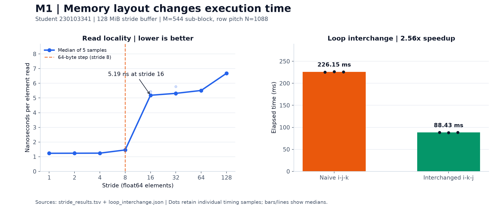
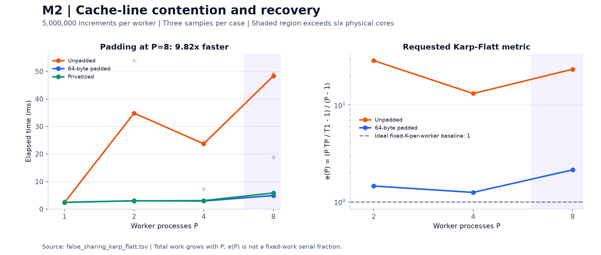
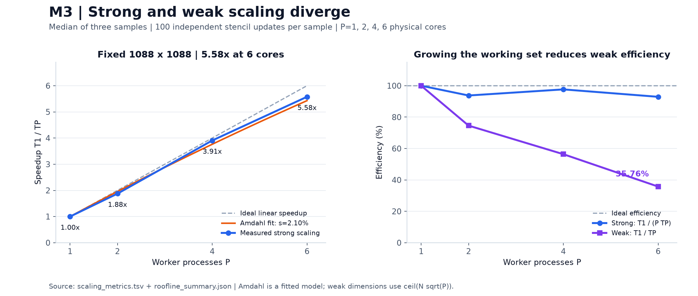
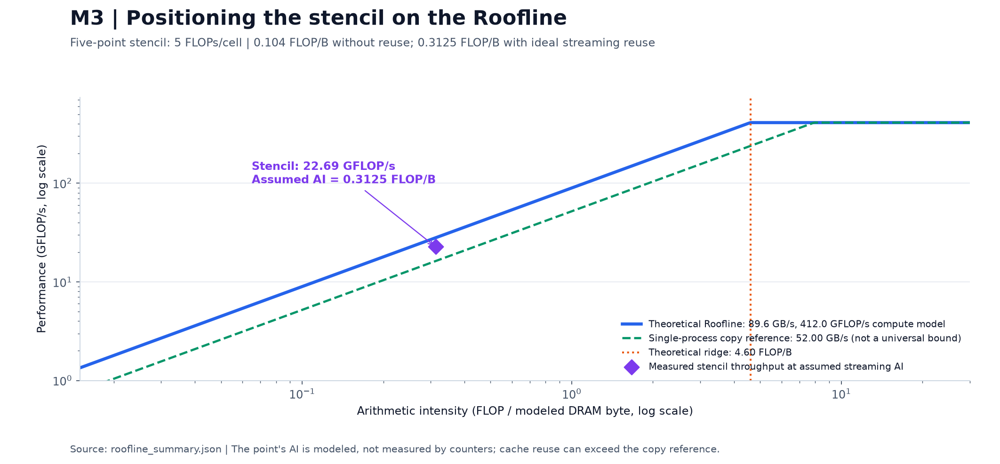
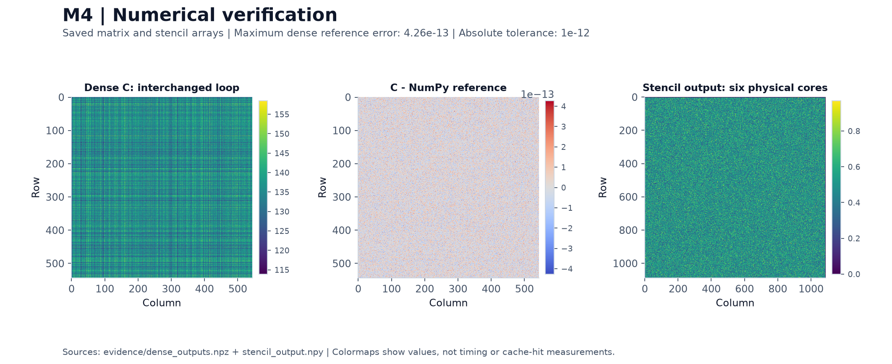

# Performance Evaluation & Optimization

### Lecture · 29 October 2026 · 11:30

**Ayazgaliyev Aibek · Student ID `230103341`**

CS482 practicum: memory hierarchy, cache-line contention, and multicore scaling.

The experiments were executed on the local **AMD Ryzen 5 7640HS**. Every chart below is generated from retained measurements or numerical outputs. The submission itself is in **[`lab-submission/`](lab-submission/README.md)**; its README is the one-paragraph summary required by Task 4.2.

## Results at a glance

| Experiment | Measured result | Main finding |
|---|---:|---|
| Matrix loop interchange | **2.56× faster** | Contiguous inner-loop access improves locality |
| False-sharing remediation, P=8 | **9.82× faster with padding** | Adjacent counters cause severe contention |
| Strong scaling, 6 physical cores | **5.58× speedup · 92.93% efficiency** | The fixed stencil workload scales well |
| Weak scaling, 6 physical cores | **35.76% efficiency** | Increasing the working set limits scaling |

**Verification:** the supplied instructor verifier generates the submission receipt. Supplementary checks independently validate matrix values, exact counters, stencil digests, timing formulas, and directory structure. The instructor verifier's non-monotonic Karp–Flatt trend warning is retained and explained below.

## Hardware and student-specific workload

| Property | Recorded value |
|---|---|
| CPU / microarchitecture | AMD Ryzen 5 7640HS / Zen 4 |
| Physical cores / logical threads | **6 / 12** |
| L1 data / L2 / shared L3 | **32 KiB per core / 1 MiB per core / 16 MiB** |
| Cache-line size | **64 bytes** |
| Memory configuration | Two firmware-labelled 64-bit DDR5-5600 channels, 16 GiB total |
| OS / runtime | Windows 11 / CPython 3.14.3 |
| Salted matrix dimension | **N = 1088** |
| Matrix sub-block / RNG seed | **M = 544 / seed = 14476** |
| Stride buffer | **16,777,216 float64 elements = 128 MiB** |

The complete nine-digit ID is passed to the handout's SHA-256 formula without truncation. Topology and cache sizes come from the Windows API; memory module data come from CIM. The microarchitecture is a labelled CPU-model lookup. See [host telemetry](lab-submission/results/host_profile.json) and [salted parameters](lab-submission/results/salted_params.json).

## M1 — Spatial locality and loop interchange



### Stride benchmark

| Stride, in float64 elements | Bytes between reads | Median ns/element |
|---:|---:|---:|
| 1 | 8 | **1.233** |
| 2 | 16 | 1.237 |
| 4 | 32 | 1.242 |
| 8 | 64 | **1.460** |
| 16 | 128 | **5.185** |
| 32 | 256 | 5.316 |
| 64 | 512 | 5.512 |
| 128 | 1024 | 6.681 |

**Observation:** stride 8 is **1.18×** slower per element than stride 1, while the pronounced cliff occurs at stride 16 on this host. A separate cache line per requested value does not imply an identical wall-time penalty on every CPU: prefetching and concurrent memory requests influence the result.

**Method:** five warmups, followed by five timed scalar reductions per stride. Each reported latency is median elapsed nanoseconds divided by the actual number of touched elements. The 128 MiB buffer exceeds the measured 16 MiB L3 cache.

### Dense matrix multiplication

| Loop order | Median of 3 runs | Relative speed |
|---|---:|---:|
| Naive `i-j-k` | **226.149 ms** | 1.00× |
| Interchanged `i-k-j` | **88.433 ms** | **2.56×** |

Both kernels use the same seeded N×N matrices and compute the M×M sub-block, retaining row pitch N. The interchanged loop hoists `A[i,k]` and traverses rows of B and C contiguously. Outputs from the two scalar loop orders are identical; maximum absolute error against the independently computed NumPy reference is **4.27e-13**, below **1e-12**.

Sources: [stride samples](lab-submission/results/stride_results.tsv) · [loop timings and digests](lab-submission/results/loop_interchange.json) · [native kernels](lab-submission/src/kernels.c).

## M2 — False sharing, padding, and privatization



| Workers | Unpadded (ms) | Padded (ms) | Privatized (ms) | Unpadded e(P) | Padded e(P) |
|---:|---:|---:|---:|---:|---:|
| 1 | 2.345 | 2.457 | 2.437 | — | — |
| 2 | 34.849 | 3.025 | 2.999 | 28.727 | 1.463 |
| 4 | 23.706 | 2.930 | 3.077 | 13.148 | 1.256 |
| 8 | **48.338** | **4.922** | 5.870 | 23.419 | 2.146 |

**Observation:** at eight workers, padding is **9.82× faster** than adjacent counters. Every variant finishes with exactly **40,000,000** increments. The unpadded implementation is slower than its one-worker baseline despite using more workers.

**Method:** 64-byte-aligned shared int64 storage; adjacent counters are eight bytes apart, padded counters 64 bytes apart. Every worker performs 5,000,000 increments. Native volatile loads/stores prevent the increment loop from being optimized into one final addition; privatization uses process-private storage and one locked shared write. Lock-free shared storage avoids accidentally benchmarking a global `multiprocessing.Array` lock. A literal Python-loop backend is also available.

Workers are pinned to distinct physical cores first. **P=8 includes SMT siblings** on this six-core machine; the chart shades that region. All three raw trials remain in the table, including scheduling outliers.

<details>
<summary><strong>Why the teacher verifier reports a Karp–Flatt trend warning</strong></summary>

The requested formula is:

```text
S(P) = T1 / TP
e(P) = (P × TP / T1 − 1) / (P − 1)
```

The measured unpadded values **28.727 → 13.148 → 23.419** are not monotonic, so the instructor verifier emits a warning. The raw timings still show clear contention and recovery with padding; they have not been adjusted to force a preferred trend.

Also, K is fixed **per worker**, so total work grows with P. Even ideal flat runtime gives **e(P)=1**, not zero. The TSV retains the requested formula and adds throughput-normalized diagnostics in separate columns. These weak-scaling values should not be interpreted as a fixed-work serial fraction.

</details>

Source: [all 36 counter runs and Karp–Flatt calculations](lab-submission/results/false_sharing_karp_flatt.tsv).

## M3 — Strong and weak scaling



Each sample performs **100 independent evaluations** of the same five-point stencil input. Output rows are partitioned across processes; boundaries remain zero.

| Workers | Strong median (ms) | Strong speedup | Strong efficiency | Weak N | Weak median (ms) | Weak scaled speedup | Weak efficiency |
|---:|---:|---:|---:|---:|---:|---:|---:|
| 1 | 144.927 | 1.00× | 100.00% | 1088 | 146.338 | 1.00× | 100.00% |
| 2 | 77.278 | 1.88× | 93.77% | 1539 | 196.192 | 1.49× | 74.59% |
| 4 | 37.102 | 3.91× | 97.65% | 2176 | 259.517 | 2.26× | 56.39% |
| 6 | **25.991** | **5.58×** | **92.93%** | 2666 | **409.172** | **2.15×** | **35.76%** |

- **Strong scaling:** fixed 1088×1088 grid. Least-squares Amdahl fitting gives **s = 0.02102**, with a model-only asymptotic ceiling **1/s = 47.57×**. This extrapolation is not a claim that the six-core host can achieve that speedup.
- **Weak scaling:** dimensions are `ceil(N × sqrt(P))`; actual interior-cell work includes rounding and boundaries. Increasing the problem size reduces efficiency substantially.
- **Gustafson comparison:** projecting the strong-fit serial fraction gives **5.89×** at six workers; the measured conventional weak scaled speedup is **2.15×**. The projection does not capture the growing working set's cache/bandwidth effects.
- **Timing scope:** the primary time includes common start release and completion messages, excluding spawn/import/setup/join. Full lifecycle times are retained separately.

The table uses conventional weak scaled speedup `WP × T1 / (W1 × TP)`. The handout's `P × W1 × T1 / (WP × TP)` is also recorded, under `handout_scaled_speedup`; when WP≈P×W1 it behaves like weak efficiency.

Source: [all 24 scaling runs](lab-submission/results/scaling_metrics.tsv).

## M3 — Roofline positioning



| Quantity | Value / interpretation |
|---|---|
| Work per interior cell | Four additions + one multiplication = **5 FLOPs** |
| AI without input reuse | **5/48 = 0.1042 FLOP/B** |
| AI with ideal streaming reuse | **5/16 = 0.3125 FLOP/B** |
| DDR5 payload bandwidth model | **89.6 GB/s** |
| Measured NumPy copy bandwidth | **52.00 GB/s** |
| Nominal Zen 4 FP64 compute model | **412.03 GFLOP/s** |
| Theoretical ridge point | **4.60 FLOP/B** |
| Theoretical streaming stencil roof | **28.00 GFLOP/s** |
| Best measured strong stencil throughput | **22.69 GFLOP/s** |

**Conclusion:** the stencil lies on the **memory-bound side of the theoretical streaming Roofline** because its arithmetic intensity is well below the ridge. DRAM traffic is modeled rather than counted. Write allocation can increase traffic; cache reuse, scalar instruction throughput, and coordination overhead affect the measured run.

The measured stencil exceeds the **16.25 GFLOP/s** reference derived from single-process copy bandwidth. That reference is not a universal ceiling for a multi-process stencil with cache reuse. The compute ceiling assumes two 256-bit FP64 FMA pipelines per core at nominal frequency; the scalar kernel does not implement that ideal vectorized workload.

Source: [Roofline inputs, assumptions and fitted models](lab-submission/results/roofline_summary.json).

## M4 — Numerical output and verification



These are images of the **retained numerical arrays**, not simulated cache behavior or illustrative data.

| Check | Result |
|---|---|
| Student salting and topology | **PASS** |
| All eight stride reductions | **PASS** |
| Matrix outputs against regenerated reference, atol=1e-12 | **PASS** |
| Individual counts across all 36 counter runs | **PASS** |
| All 24 stencil run digests against regenerated references | **PASS** |
| Timing medians, scaling formulas, schema fields and layout | **PASS** |
| Complete supplied instructor verifier | **Completed; one Karp–Flatt trend warning** |

The instructor's **unchanged** [`verify_outputs.py`](lab-submission/verify_outputs.py) produces [`verification_receipt.sig`](lab-submission/results/verification_receipt.sig) in its required three-line format. Supplementary numerical checks are implemented separately in [`verify_local_outputs.py`](verify_local_outputs.py), with their log and hash manifest under `evidence/`.

Both matrix loop orders share the salted numerical digest:

```text
7049e0236c702aa0cf42937108ce8d09e9267e4d98726a7ad8483eabd3626ab8
```

See [verification console output](evidence/verification.log) and [local numerical verification manifest](evidence/local_verification.json).

## Submission layout

`lab-submission/results/` contains **exactly the eight deliverables from the PDF**. Logs and supporting numerical evidence are outside that directory; redundant stencil array copies have been removed.

```text
lecture_task_29.10.2026_11.30/
├── README.md                    # Illustrated lecture report
├── make_plots.py                 # Rebuild the five figures from saved results
├── requirements-plots.txt        # Optional plotting dependencies
├── plots/                       # Five PNGs + input/output hash manifest
├── evidence/                    # Logs, counter values, digests, two retained array files
├── verify_local_outputs.py      # Supplementary numerical verification
└── lab-submission/
    ├── README.md                # Required one-paragraph summary
    ├── verify_outputs.py        # Complete instructor-provided verifier
    ├── run_all.py
    ├── requirements.txt
    ├── src/
    │   ├── profile_env.py
    │   ├── salt.py
    │   ├── stride_bench.py
    │   ├── dense_kernel.py
    │   ├── false_sharing.py
    │   ├── scaling_study.py
    │   └── ...                  # Shared ctypes/build and export-schema helpers
    └── results/
        ├── host_profile.json
        ├── salted_params.json
        ├── stride_results.tsv
        ├── loop_interchange.json
        ├── false_sharing_karp_flatt.tsv
        ├── scaling_metrics.tsv
        ├── roofline_summary.json
        └── verification_receipt.sig
```

## Reproduce

Run these commands **from this lecture folder**.

### Verify the retained submission

```powershell
python -m pip install -r lab-submission/requirements.txt
python lab-submission/run_all.py --verify-only
```

This runs the instructor verifier from its expected working directory and then the independent numerical checks. It saves verification logs in `evidence/` without rerunning the benchmarks.

### Regenerate only the report images

```powershell
python -m pip install -r requirements-plots.txt
python make_plots.py
```

The plotting script checks medians against raw samples, validates image links, and records input hashes. It does not modify the measurements.

### Rerun the full benchmark suite

```powershell
python lab-submission/run_all.py --student-id 230103341
python make_plots.py
```

Python 3.10+, NumPy, and a matching 64-bit GCC/Clang toolchain are needed. Hardware profiling targets Windows. Native kernels are loaded through standard-library `ctypes`; generated libraries stay in ignored `build/`. A full rerun replaces the retained timings with new real measurements; report tables may then need updating.

## Git checkpoints and timing

| Tag | Required commit message |
|---|---|
| `M0-ENV` | `M0: Environment and salting configuration` |
| `M1-LOCALITY` | `M1: Memory stride and loop interchange benchmarking` |
| `M2-SHARING` | `M2: False sharing reproduction and Karp-Flatt analysis` |
| `M3-SCALING` | `M3: Strong and weak scaling evaluation` |
| `M4-FINAL` | `M4: Final verification and completed practicum submission` |

The retained benchmark run was captured **29.10.2026, 12:22:10–12:22:53, UTC+05:00**, taking **42.98 seconds**. The initial implementation was pushed as `0ff72e6`; subsequent commits/tags record submission-layout corrections and final verification at their actual times. They do not retroactively establish original experiment checkpoints. Historical logs retain the paths used during measurement. The configured submission remote is the repository's existing GitHub `origin`.
