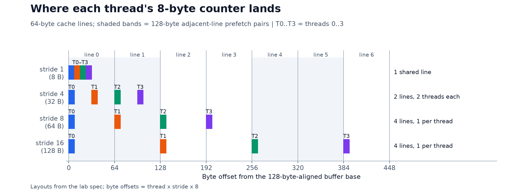
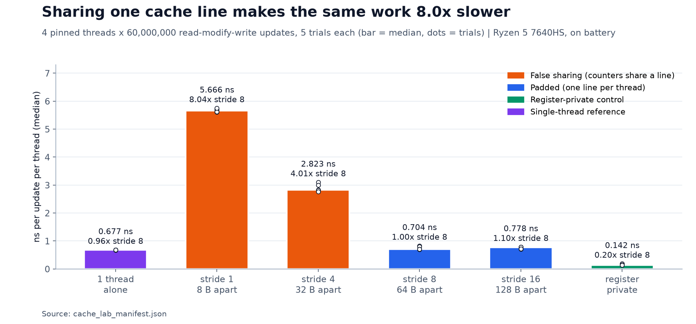
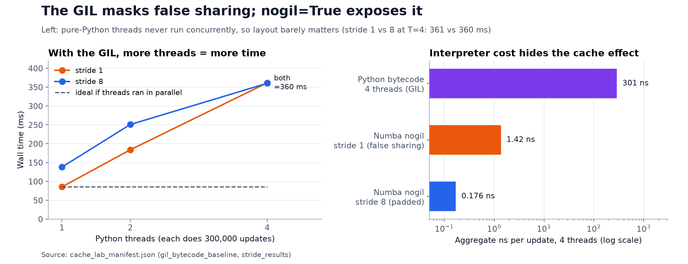

# Cache Line & False Sharing Mechanics in Multi-Core Python

### Practice lab · 19 November 2026 · 14:30

**Ayazgaliyev Aibek · Student ID `230103341` · Git `Stierlitzx`** · Instructor: Sufyan bin Uzayr

> **Second practice lab of this session:** [`hybrid_mpi_cuda_cache_lab/`](hybrid_mpi_cuda_cache_lab/README.md) — the
> same cache-line effect measured across MPI processes, combined with a GPU stencil on a Colab Tesla T4.

Four threads each increment **their own** counter 60 million times. They never touch each other's data, yet
depending on how far apart the counters sit in memory, the same work takes anywhere from **42 ms to 340 ms**. The
reason is *false sharing*: CPUs keep caches in sync in 64-byte blocks (cache lines). Two counters in the same block
force the cores to pass the whole block back and forth on every write.

Plain Python threads can't show this because of the GIL, so the workers are compiled with **Numba
`@njit(nogil=True)`** and pinned to four different physical cores.

---

## Results at a glance

| Layout | Gap between counters | Time per update | vs. padded |
|---|---:|---:|---:|
| **stride 1** — all 4 counters in one cache line | 8 B | **5.666 ns** | **8.04× slower** |
| **stride 4** — 2 counters per line | 32 B | 2.823 ns | 4.01× slower |
| **stride 8** — one line per thread | 64 B | 0.704 ns | baseline |
| **stride 16** — one 128-byte pair per thread | 128 B | 0.778 ns | 1.10× (within noise) |
| Register-private (write memory once at the end) | — | 0.142 ns | 4.97× faster |
| One thread alone | — | 0.677 ns | 0.96× |

| Check | Result |
|---|---|
| Final counters identical across all layouts, trials and the private version | **Yes, bit-exact** |
| Compiled loop really writes memory every iteration (LLVM IR) | **Yes**: 9 `load i64` + 9 `store i64` in the loop |
| GIL actually released | **Yes**: 4 padded threads run as fast as 1 thread |
| `verification_passed` | **true** |

## Hardware and setup

| Property | Value |
|---|---|
| CPU | AMD Ryzen 5 7640HS (Zen 4), **6 cores / 12 threads**, 64-byte cache lines |
| Pinning | One thread per physical core: logical CPUs **0, 2, 4, 6** (`SetThreadAffinityMask`) |
| OS / runtime | Windows 11, CPython 3.14.3 (GIL on), NumPy 2.5.3, Numba 0.67.0 |
| Workload | 4 threads × **60,000,000** read-modify-write updates, **5 trials** per layout, median reported |
| Power | Laptop on battery (54 %); absolute times depend on clock speed, ratios are what matter |
| Seed | `INSTANCE_SEED = 16200051438975350361`, from SHA-256 of Git handle + CPU signature |

---

## 1 — Where the counters land



With stride 1 all four counters live in **line 0**, so every write by any core invalidates the other three copies.
With stride 4 two threads share each line. From stride 8 on, every thread owns a private line, and stride 16 also
gives each thread its own 128-byte pair (relevant for the adjacent-line prefetcher, see Q3).

## 2 — Same work, up to 8× slower



* **Stride 1 → 8.04× slower.** Each store needs exclusive ownership of the line (an RFO request), the other cores
  lose their copy, and the line ping-pongs between all four cores.
* **Stride 4 → 4.01× slower.** Only two cores fight over each line, so the overhead roughly halves.
* **Stride 8 ≈ 1 thread alone.** Once each core owns its line, 4 threads run as fast as 1, which shows the GIL really
  is released.
* **Register-private → 5× faster than stride 8.** This separates the three costs:
  **register ≈ 0.14 ns · L1 cache ≈ 0.70 ns · cross-core coherence ≈ 5.67 ns** per update.
* **Stride 16 vs stride 8:** the trials overlap (best-case ratio 1.013), so there is no measurable prefetcher penalty
  for this access pattern.

## 3 — Why plain Python threads can't show false sharing



With ordinary Python threads only one thread runs at a time (the GIL), so adding threads just adds waiting: 85 ms
for 1 thread, 184 ms for 2, **361 ms for 4**. The memory layout barely matters (stride 1 and stride 8 both take
≈360 ms with 4 threads). Each Python update costs ~300 ns of interpreter work, about 60× more than the ~5 ns
false-sharing penalty it would need to reveal.

## 4 — Making sure the compiler doesn't cheat

An optimizing compiler would happily keep `buffer[slot]` in a register and write it to memory once at the end. That
would make every layout equally fast and hide false sharing completely. The lab demonstrates this with a control
loop:

| Kernel | What LLVM generated | Stride-1 time |
|---|---|---:|
| Naive `buffer[slot] += …` | Value moved into registers and **vectorized**, no store inside the loop | 8.5 ms |
| **Lab kernel** `buffer[slot + (x & mask)] += …` with `mask = 0` at run time | Real `load i64` + `store i64` every iteration | 339.9 ms |

The compiler can't prove `x & mask` is always 0, so it must touch memory on every iteration. The details and IR
excerpts are in Q4 of [`ANALYSIS.md`](ANALYSIS.md).

---

## Key takeaways

1. **Independent data can still collide**: four private counters in one 64-byte line made the work **8× slower**.
2. **Padding to 64 bytes fixes it completely** here; 128-byte padding brought no extra gain for this access pattern.
3. **Keeping hot values in a local variable is faster still**: ~5× over padded memory updates.
4. **Benchmarks must defeat the optimizer and the GIL**, or they measure nothing: checked through the IR audit and the
   1-thread vs 4-thread comparison.

## Files

| File | What it is |
|---|---|
| [`false_sharing_lab.py`](false_sharing_lab.py) | The lab (Tasks 1–5). `python false_sharing_lab.py [--quick]` |
| [`cache_lab_manifest.json`](cache_lab_manifest.json) | All measured results (`verification_passed: true`) |
| [`ANALYSIS.md`](ANALYSIS.md) | Answers to Q1–Q5 (MESI, slowdown math, prefetcher, LLVM IR, GIL) |
| [`full_run_2026-11-19.txt`](full_run_2026-11-19.txt) | Raw console output of the full run |
| `llvm_*.ll` | Compiled LLVM IR of the three kernels |
| [`make_plots.py`](make_plots.py) · [`plots/`](plots/) | Draws the charts above from the manifest |

## Reproduce

```powershell
py -3.14 false_sharing_lab.py --quick   # ~2 s sanity check
py -3.14 false_sharing_lab.py           # full run: writes cache_lab_manifest.json and llvm_*.ll
py -3.14 make_plots.py                  # redraw the charts
```

Results depend on the CPU, power mode and background load. The seed changes with the Git handle and CPU.
