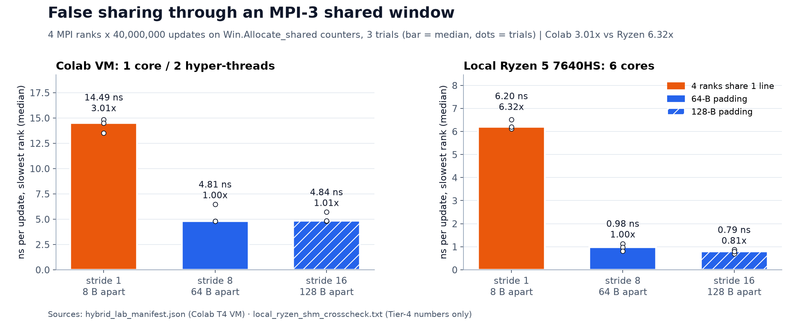
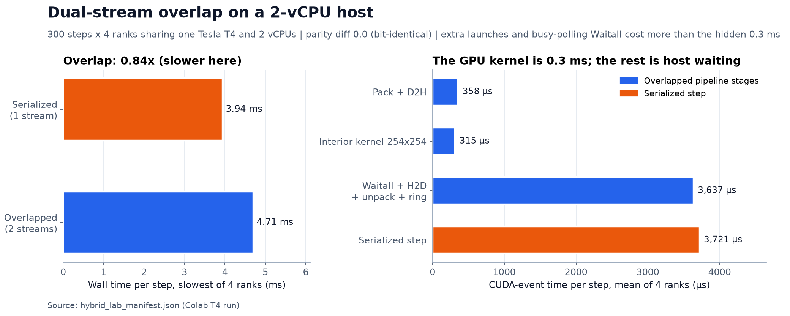
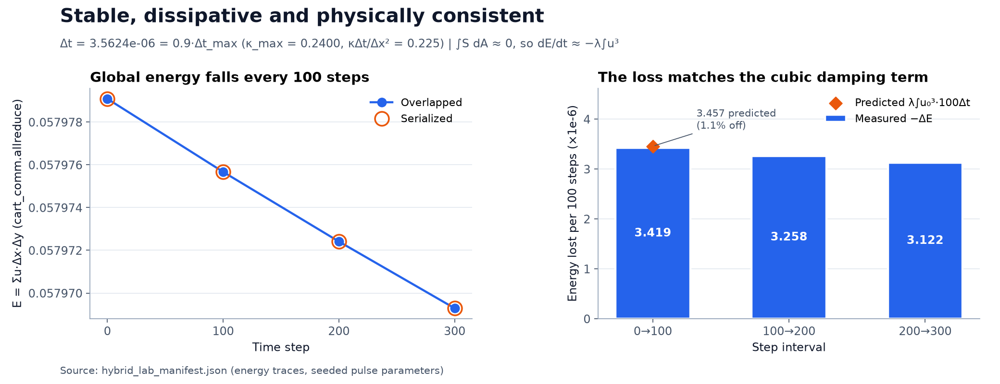

# Hybrid MPI-CUDA Stencil & Cross-Tier Cache-Line Coherency

### Practice lab (ungraded, solo) · 19 November 2026 · 14:30

**Ayazgaliyev Aibek · Student ID `230103341` · GitHub `Stierlitzx`** · Instructor: Sufyan bin Uzayr

This lab joins the morning's two topics in one program run by **4 MPI processes**:

* **GPU side:** a heat-like simulation split across the 4 processes on one Tesla T4. They exchange their border strips
  every step and update their cells with a shared-memory GPU kernel, in a serialized and a dual-stream overlapped
  version.
* **CPU side:** the same 4 processes share one block of host memory (an MPI-3 shared window) and hammer 8-byte
  counters placed 8, 64 or 128 bytes apart, to measure **false sharing between processes**.

Executed top to bottom on **Google Colab (Tesla T4, 2 vCPUs)**. A local run on a 6-core Ryzen is included for
comparison.

---

## Results at a glance

| Question | Answer from the run |
|---|---|
| Do both GPU pipelines compute the same thing? | **Yes, bit-for-bit** (max difference **0.0**) |
| Did overlapping help on this machine? | **No: 0.84×** (3.94 → 4.71 ms per step), because 4 processes shared only 2 vCPUs |
| GPU kernel uses shared memory + barrier? | **Yes**: PTX **5** `st.shared.f64` · **5** `ld.shared.f64` · **1** `bar.sync` |
| False sharing between processes, Colab | **3.01× slower** with all 4 counters in one cache line |
| False sharing between processes, 6-core Ryzen | **6.32× slower** |
| Does 128-byte padding beat 64-byte? | **No measurable difference** on Colab (1.008×) |
| CPU loop really writes memory every iteration? | **Yes**: LLVM loop has real `load i64` + `store i64`, nothing vectorized |
| Stable and physically consistent? | **Yes**: Δt = 0.9 × limit, energy falls every 100 steps, loss matches theory within **1.1 %** |
| `verification_passed` | **true** (all 7 checks) |

## Hardware and setup

| Property | Colab (official run) | Local cross-check |
|---|---|---|
| GPU | Tesla T4, CC 7.5, UUID `GPU-6c19b838-7a5d-1355-0fdd-83ef8e21deb2` | — (GPU part simulated, not timed) |
| CPU | Intel Xeon @ 2.00 GHz, **2 vCPUs = 1 core / 2 hyper-threads** | AMD Ryzen 5 7640HS, **6 cores / 12 threads** |
| MPI | Open MPI 4.1.6, 4 ranks, 2 × 2 Cartesian grid | MS-MPI 10.1, 4 ranks |
| Stencil | 512 × 512 grid, 258 × 258 per rank, 300 steps per pipeline | — |
| Shared window | 64 × `uint64`, base **128-byte aligned**, 40,000,000 updates per rank, 3 trials | same |
| Seed | `INSTANCE_SEED = 8070547215371552121` (GitHub handle + GPU UUID + CPU signature) | — |

---

## 1 — False sharing across MPI processes

All 4 processes map **the same physical memory**, so two counters 8 bytes apart sit in the same 64-byte cache line no
matter which process owns them. Every write forces the other cores to give up their copy of the line.

| Layout | Colab (2 vCPU) | Ryzen (6 cores) |
|---|---:|---:|
| stride 1 — 8 B apart, **1 shared line** | 579.5 ms · 14.49 ns/update | 247.9 ms · 6.20 ns/update |
| stride 8 — 64 B apart | 192.2 ms · 4.81 ns/update | 39.2 ms · 0.98 ns/update |
| stride 16 — 128 B apart | 193.8 ms · 4.84 ns/update | 31.6 ms · 0.79 ns/update |
| **Slowdown from false sharing** | **3.01×** | **6.32×** |

**Why the two machines differ:** on the Ryzen the 4 processes run on 4 separate cores, so the full cross-core cost
appears. On Colab the 2 vCPUs are two hyper-threads of **one** core that share the same L1 cache. Their contention
shows up as pipeline flushes rather than full cache-line transfers, and 4 processes also take turns on 2 hardware
threads. False sharing still costs **3–6×** on both.

## 2 — GPU overlap on a starved host

The overlapped pipeline computes the interior while border data travels between processes. On this VM it was
**slower (0.84×)**. The GPU work it can hide is only **0.3 ms** per step, while each step needs CPU time from all 4
processes for kernel launches, synchronization and MPI. Open MPI's `Waitall` spins on the CPU while it waits. With 4
processes on 2 vCPUs, the extra launches of the overlapped version cost more than they hide. The morning lab's
solver (same design, another Colab VM) got 2.38×, so on Colab the result depends on the host CPU more than on the GPU.

## 3 — Stable and energy-consistent

| Step | Global energy (allreduce) | Lost in the last 100 steps |
|---:|---:|---:|
| 0 | 0.0579790886 | — |
| 100 | 0.0579756693 | 3.419 × 10⁻⁶ |
| 200 | 0.0579724113 | 3.258 × 10⁻⁶ |
| 300 | 0.0579692895 | 3.122 × 10⁻⁶ |

* **Stability limit** Δt_max = Δx² / (4·κ_max) = **3.958 × 10⁻⁶**. The run uses **3.562 × 10⁻⁶** (90 %).
* **Energy budget:** diffusion only moves heat and the source adds and removes equal amounts, so the loss should equal
  the damping term λ∫u³. Computed from the initial field this predicts **3.457 × 10⁻⁶** for the first 100 steps, and
  the run lost **3.419 × 10⁻⁶** (1.1 % apart).

## 4 — Audits

| Audit | What was checked | Result |
|---|---|---|
| GPU PTX (`tiled_stencil_kernel.inspect_asm`) | Tile loads, barrier, tile reads | `st.shared.f64` **5** · `bar.sync` **1** · `ld.shared.f64` **5** |
| CPU LLVM IR (`host_shm_accumulate.inspect_llvm`) | The counter really lives in memory | loop `B34`: **5** `load i64` + **5** `store i64`, no vectors, no calls, no Python objects |
| Ownership | No process ever holds the full grid | only rank-local 258 × 258 arrays; no gather calls |
| Shared counters | Correct final values | bit-exact on every stride, trial and rank |

---

## Key takeaways

1. **False sharing crosses process boundaries**: MPI ranks sharing one window slow down 3–6× on a shared cache line.
2. **64-byte padding is enough** here; 128-byte padding brought no measurable gain.
3. **Overlap needs spare CPU**: with 4 ranks on 2 vCPUs, the overlapped GPU pipeline lost (0.84×), although the same
   design won 2.38× in the morning lab.
4. **Every result is backed by a check**: bit-identical pipelines, PTX and LLVM audits, CFL, and an energy budget
   within 1.1 %.

## Run history (honest record)

The first Colab run failed one check (`shm_counters_bit_exact`) because of a race in my benchmark code. After the
closing barrier, rank 0 cleared the shared counters for the next trial while slower ranks were still reading theirs
(4 ranks on 2 vCPUs exposed it; 12 local threads never did). The fix is for each rank to read its own counter right
after its own loop. The notebook was rebuilt and re-run from the top on a fresh T4, and that run is the one in this
folder.

## Questions Q1–Q6

Answered in the last cell of [`hybrid_mpi_cuda_cache_lab.ipynb`](hybrid_mpi_cuda_cache_lab.ipynb) (source:
[`answers_q1_q6.md`](answers_q1_q6.md)): GPU sectors vs CPU lines, the PTX audit and warp hazards, shared-GPU
overlap, MESI ping-pong in the shared window, prefetcher pairing vs padding cost, and CFL/energy.

## Files

| File | What it is |
|---|---|
| [`hybrid_mpi_cuda_cache_lab.ipynb`](hybrid_mpi_cuda_cache_lab.ipynb) | Notebook exactly as executed on Colab (all outputs) + Q1–Q6 answers |
| [`hybrid_mpi_cuda_cache.py`](hybrid_mpi_cuda_cache.py) | The program (identical to the notebook's `%%writefile` cell) |
| [`hybrid_lab_manifest.json`](hybrid_lab_manifest.json) | Machine-readable results (`verification_passed: true`; hashes verified) |
| [`hybrid_stdout_colab_t4.txt`](hybrid_stdout_colab_t4.txt) | Raw console output of the Colab run |
| [`local_ryzen_shm_crosscheck.txt`](local_ryzen_shm_crosscheck.txt) | Local 6-core run: only the shared-window and LLVM parts are real; the GPU part ran in a simulator on a tiny grid |
| [`make_plots.py`](make_plots.py) · [`plots/`](plots/) | Draws the charts above from the manifest and the local log |
| [`make_notebook.py`](make_notebook.py) | Builds the notebook from the program file |

## Reproduce

1. Open [`hybrid_mpi_cuda_cache_lab.ipynb`](hybrid_mpi_cuda_cache_lab.ipynb) in Colab, select a **T4 GPU** runtime,
   then **Runtime → Run all**.
2. Redraw the charts locally with `python make_plots.py`.

A new Colab session gets a new GPU UUID, so the seed, the pulses and all numbers change.
