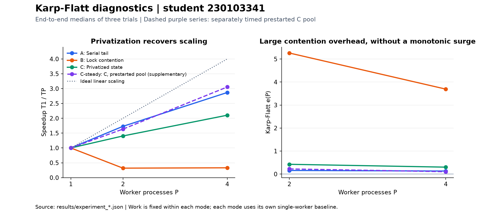
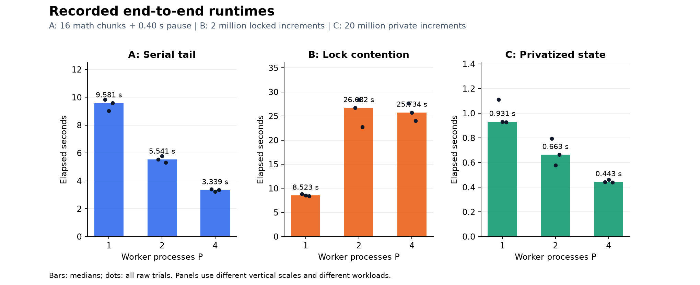

# Empirical Scalability Diagnostics: Karp–Flatt

### Practice · 29 October 2026 · 14:30

**Ayazgaliyev Aibek · Student ID `230103341`**

**Instructor:** Sufyan bin Uzayr · **Format:** ungraded solo practice · **Submission branch:** `practice-230103341`.

Three fixed-work Python experiments distinguish an intentional serial pause, shared-lock contention, and process-local accumulation. The required workload sizes and startup-inclusive timing boundaries follow the supplied handout. The results below are measured on the local machine.

## Results at a glance

| Experiment | One worker | Four workers | Four-worker result |
|---|---:|---:|---|
| **A — 0.40 s serial tail + 16 math chunks** | 9.581 s | 3.339 s | **2.87× speedup**; approximately flat Karp–Flatt metric |
| **B — 2,000,000 locked increments** | 8.523 s | 25.734 s | **3.02× slower**; severe synchronization overhead |
| **C — 20,000,000 private increments** | 0.931 s | 0.443 s | **2.10× speedup**, **52.60% efficiency**, including pool startup |
| **C, prestarted-pool diagnostic** | 0.828 s | 0.271 s | **3.05× speedup**, **76.37% efficiency**, excluding startup/shutdown |

The prestarted-pool measurement is supplementary. The primary A/B/C table retains the handout's end-to-end timing, including process/pool startup, IPC and shutdown.

## Hardware and execution

| Property | Recorded value |
|---|---|
| CPU | AMD Ryzen 5 7640HS with Radeon 760M Graphics |
| Physical cores / logical threads | **6 / 12** |
| Operating system | Windows 11 |
| Python | CPython **3.14.3**, 64-bit |
| Multiprocessing start method | **spawn** |
| Worker counts / repetitions | **P=1,2,4 / three trials per configuration** |
| CPU placement | OS-managed; no affinity or power-plan changes |
| Clock | `perf_counter_ns`; reported resolution **100 ns** |

The scheduled session is **29.10.2026 at 14:30**. Captured execution timestamps are in each raw JSON file and the [full results report](RESULTS.md#execution-provenance). The folder's initial 20.10 label was corrected after the user's clarification; completed measurements were preserved.

## Experiment A — The stubborn serial tail

[`exp_a_serial.py`](exp_a_serial.py) sleeps for **0.40 seconds** before constructing a process pool, then dispatches **16 chunks**. Every chunk computes:

```python
sum(math.sin(i) * math.cos(i) for i in range(1, 2_000_000))
```

Total mathematical work is fixed at **31,999,984 iterations**, independent of worker count. Chunk results and the reduction checksum are verified outside the timed interval.

**Observed:** `e(2)=0.156722`, `e(4)=0.131374`; the ratio **0.838** satisfies the handout's **[0.80, 1.25]** flatness criterion. The pause alone is approximately **4.18%** of this machine's T1, so the handout's “~12%” comment does not transfer directly. Startup, scheduling and IPC also contribute to the empirical metric.

## Experiment B — The contention traffic jam

[`exp_b_contention.py`](exp_b_contention.py) divides **2,000,000 total increments** among workers. Each increment takes the same explicit shared mutex and updates the handout's synchronized `Value('i', 0)`.

**Observed:** four workers take **25.734 s**, compared with **8.523 s** at one worker. The final count is exactly **2,000,000** in every trial. Both Karp–Flatt values are very large: **5.261** at P=2 and **3.693** at P=4.

The contention slowdown is reproduced, but the metric **does not grow from P=2 to P=4** in this run. The report records that unmet trend criterion. These timings measure the combined explicit-lock and synchronized-Value implementation; they do not isolate cache-line coherence traffic or prove a unique hardware cause.

## Experiment C — Privatize before synchronizing

[`exp_c_fixed.py`](exp_c_fixed.py) performs **20,000,000 total increments** in private local scalars, then reduces the returned partial sums once. No shared counter or mutex is touched inside the worker loop.

**Observed:** end-to-end runtime falls from **0.931 s to 0.443 s**, but four-worker efficiency is **52.60%**, below the requested 70%, and `e(4)=0.300413` is above the illustrative 0.03 target.

A single separately labelled **prestarted-pool diagnostic** confirms every child is ready before starting its timer. It reaches **76.37% efficiency** at four workers, while retaining full lifecycle timings separately. This supports startup/coordination overhead as a contributor. The primary results have not been replaced by this shorter timing boundary.

## Visual diagnostics



**How to read it:** every curve uses its own single-worker baseline. A remains approximately flat in e(P), B has a large contention penalty, and C improves scaling by eliminating shared updates. The dashed series is the supplementary C timing.



Bars show medians; dots retain every trial, including outliers. Panels use different time scales. **B and C have different total work**, so their raw runtime ratio is not a same-work optimization speedup.

## Required metrics and rubric observations

```text
S(P) = T1 / TP
E(P) = S(P) / P × 100%
e(P) = (P × TP / T1 − 1) / (P − 1), P ≥ 2
```

| Check from the handout | Observation |
|---|---|
| A: e(4)/e(2) in [0.80, 1.25] | **Met: 0.838** |
| B: T4 > T1 | **Met: T4/T1 = 3.02** |
| B: e(4) much greater than e(2) | **Not observed: 3.693 < 5.261** |
| C: T4 < T1 | **Met: 2.10× speedup** |
| C: end-to-end E4 > 70% | **Not observed: 52.60%** |
| Supplementary prestarted C: E4 > 70% | **Met: 76.37%**, different timing scope |

See **[RESULTS.md](RESULTS.md)** for full-precision tables, all timing samples, workload details and interpretation. The required repository-root **[RESULTS.md](../RESULTS.md)** contains the submission summary.

## Files

| File | Purpose |
|---|---|
| `exp_a_serial.py` | Required serial-tail experiment |
| `exp_b_contention.py` | Required lock-contention experiment |
| `exp_c_fixed.py` | Required privatization experiment and optional startup diagnostic |
| `benchmark_support.py` | Standard-library topology, partitioning, timing and metric helpers |
| `analyze_results.py` | Check raw records, regenerate RESULTS.md files, TSV and optional images |
| `test_experiments.py` | Seven small correctness tests, including actual worker processes |
| `results/host_profile.json` | Actual host and Python telemetry |
| `results/experiment_*.json` | Raw samples, exact totals/checksums, medians and derived metrics |
| `results/scaling_metrics.tsv` | Combined A/B/C and supplementary metric rows |
| `results/verification.json` | Data/metric verification and separate observed rubric flags |
| `plots/` | Two charts rendered from the retained records |

Only small telemetry files and images are stored; no large arrays are generated by this practice.

## Reproduce

All benchmark and correctness scripts use the **Python standard library**. Run from this practice folder:

```powershell
python test_experiments.py
python exp_a_serial.py
python exp_b_contention.py
python exp_c_fixed.py
python exp_c_fixed.py --steady-state
python analyze_results.py
```

Default scripts run three trials at P=1,2,4. B deliberately performs millions of expensive locked accesses and can take several minutes on Windows. Completed samples are saved after each case; rerunning an interrupted experiment resumes compatible partial records. Rerunning a completed experiment starts fresh measurements.

To regenerate the images from saved results:

```powershell
python -m pip install -r requirements-plots.txt
python analyze_results.py --plots
```

Changing workload sizes with `--chunk-size`, `--total-chunks` or `--total-increments` is supported for exploration; the submission analyzer requires the handout's default sizes and three trials. The supplied examples require Python 3.8+; this measured run used 3.14.3.

## Verification and Git checkpoints

**Seven correctness tests passed**, covering fixed-work partitioning with remainders, invalid inputs and overflow, known analytical metrics, negative speedup, actual serial-pause/pool results, and exact totals with real contended/private workers. Raw-data analysis checks **36 captured samples** across the three experiments and the supplementary diagnostic. Performance targets are reported independently from numerical correctness.

The branch follows the handout's required checkpoint messages:

1. `Part 1: Experiment A complete`
2. `Part 2: Captured lock contention pathology and Karp-Flatt surge`
3. `Part 3 & 4: Completed privatization fix and verified RESULTS.md`

The second message is the prescribed checkpoint title; the measured e(P) trend is documented above. Push target: **`origin practice-230103341`**. Instructor in-person/Git sign-off is external to these local checks.
